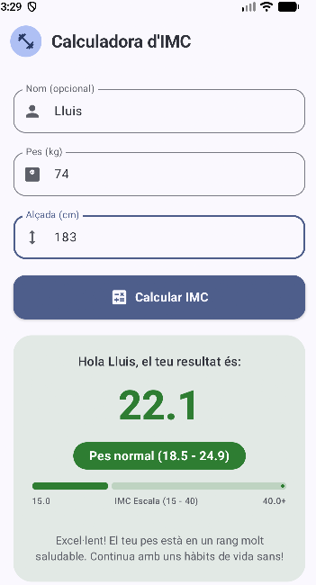
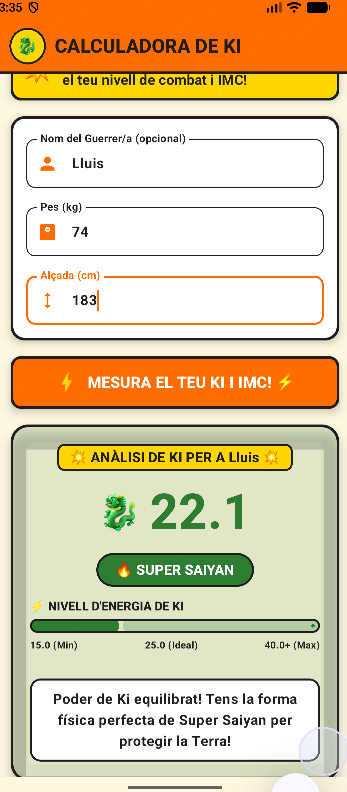

# Calculadora de BMI amb Jetpack Compose

Aplicació Android per a calcular l'Índex de Massa Corporal (BMI), desenvolupada amb Jetpack Compose.

> 🖍️ **Disseny del projecte:** 

| Interfície Material 3 | Interfície Còmic / Bola de Drac |
| :---: | :---: |
| | |

---

## 🛠️ Tecnologies Utilitzades

- **Llenguatge:** [Kotlin](https://kotlinlang.org/)
- **UI Framework:** [Jetpack Compose](https://developer.android.com/jetpack/compose)
- **Disseny:** Material Design 3